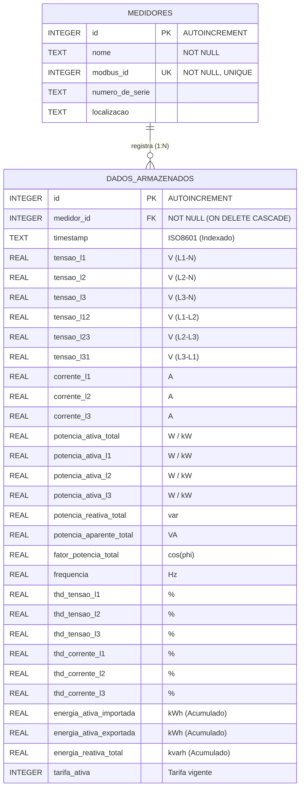

# opta-advanced-electricity-monitor
Part of the code uploaded to the Arduino OPTA PLC microcontroller for a maker lab at a SENAI institution.

# Bibliotecas incluídas
- STM32RTC.h
- cstdint.h
- string.h
- lfs.h

# Sistema de arquivos e desgaste
Microcontrolador STM32H747XIH6 tem internamente uma memória Flash QSPI externa do slício/die de 16Mb soldada na placa lógica

## Especificações do circuito integrado de memória Flash QSPI
### Hardware low-level
| Função | Especificação |
| --- | --- |
| **Tecnologia da flash**      | Flash NOR Serial (Quad-SPI / QSPI) |
| **Capacidade em Megabytes**  | 16 MB                              |
| **Capacidade em bytes**      | 16.777.216 bytes                   |
| **Faixa Térmica do Sistema** | -20 °C a +50 °C                    |
- Barramento no STM32H747XIH6:
	- QSPI.CLK: Pino PB2 (R6)
	- QSPI.CS: Pino PG6 (F15)
	- QSPI.D0 (IO0): Pino PD11 (R15)
	- QSPI.D1 (IO1): Pino PD12 (T15)
	- QSPI.D2 (IO2 / WP#): Pino PE2 (C7)
	- QSPI.D3 (IO3 / HOLD#): Pino PD13 (R17)

### Armazenamento
| Função | Descrição | Capacidade |
| --- | --- | --- |
| **`Page program`**   | Unidade mínima de escrita    | 256 bytes                    |
| **`Sector Erase`**   | Unidade mínima de apagamento | 4096 bytes                   |
| **`Block Erase`**    | Tamanho dos blocos           | 32KB e 64KB                  |
| **`Setores totais`** | 4096 setores de 4KB cada     | NC                           |
| **`Endurace`**       | Ciclo de vida de setor       | 100.000 escritas/apagamentos |
| **`Data Life`**      | Retenção de dados            | 20 anos a 85 graus CELCIUS   |
### Sistemas de segurança
| Tecnologia | Descrição |
| --- | --- |
Read Only Trigger    | Em queda brusca de energia, trava a FLASH em modo ROM
Protection Registers | Pinos físicos de protenção contra escrita

# Arquitetura do banco de dados
Banco de dados relacional embarcado em **SQLite 3**, otimizado para operar sobre o sistema de arquivos **LittleFS** e memória Flash QSPI

## 1. Diagrama Entidade-Relacionamento (ERD)

## 2. Parâmetros de Configuração (`PRAGMA`)

Diretivas aplicadas na inicialização para garantir estabilidade, baixo consumo de RAM e compatibilidade com a Flash QSPI do Finder Opta:

| Parâmetro | Valor | Função na Arquitetura Embarcada |
| :--- | :--- | :--- |
| **`page_size`** | `1024` | Alinha as páginas do banco aos blocos do LittleFS e reduz uso de RAM por página. |
| **`temp_store`** | `MEMORY` | Mantém tabelas/índices temporários na RAM (evita falha por ausência de `/tmp` no Mbed OS). |
| **`journal_mode`** | `TRUNCATE` | Substitui o `WAL` (que exige `mmap`/memória compartilhada não suportados pelo LittleFS). |
| **`cache_size`** | `-100` | Limita o cache de páginas em memória RAM a aproximadamente **100 KB**. |
| **`foreign_keys`** | `ON` | Garante integridade referencial e exclusão em cascata (`ON DELETE CASCADE`). |

---

## 3. Dicionário de Dados

### Tabela `medidores`
Armazena os metadados cadastrais dos medidores de energia conectados ao barramento RS485.

| Coluna | Tipo | Restrições | Descrição |
| :--- | :--- | :--- | :--- |
| **`id`** | `INTEGER` | `PK, AUTOINCREMENT` | Identificador interno único do medidor no banco. |
| **`nome`** | `TEXT` | `NOT NULL` | Nome amigável do ponto de medição (ex: *Quadro Geral*). |
| **`modbus_id`** | `INTEGER` | `NOT NULL, UNIQUE` | Endereço escravo Modbus RTU na rede RS485. |
| **`numero_de_serie`** | `TEXT` | — | Número de série físico lido do equipamento Finder 7M.38. |
| **`localizacao`** | `TEXT` | — | Local físico ou painel onde o medidor está instalado. |

### Tabela `dados_armazenados`
Tabela de série temporal que armazena o retrato elétrico completo de cada ciclo de leitura.

---

| Grupo | Coluna | Tipo | Unidade / Formato | Descrição |
| :--- | :--- | :--- | :--- | :--- |
| **Controle** | `id` | `INTEGER` | `PK, AUTOINCREMENT` | Identificador sequencial do registro. |
| **Controle** | `medidor_id` | `INTEGER` | `FK -> medidores(id)` | Vínculo com o medidor de origem (`ON DELETE CASCADE`). |
| **Controle** | `timestamp` | `TEXT` | `YYYY-MM-DD HH:MM:SS` | Data e hora local da coleta em formato ISO-8601. |
| **Tensões** | `tensao_l1`, `l2`, `l3` | `REAL` | Volts (`V`) | Tensões Fase-Neutro das fases 1, 2 e 3. |
| **Tensões** | `tensao_l12`, `l23`, `l31` | `REAL` | Volts (`V`) | Tensões de linha (Fase-Fase). |
| **Correntes** | `corrente_l1`, `l2`, `l3` | `REAL` | Ampères (`A`) | Corrente eficaz (RMS) por fase. |
| **Potências** | `potencia_ativa_total` | `REAL` | `W` ou `kW` | Potência ativa trifásica total ($P_t$). |
| **Potências** | `potencia_ativa_l1`, `l2`, `l3` | `REAL` | `W` ou `kW` | Potência ativa individual por fase. |
| **Potências** | `potencia_reativa_total` | `REAL` | `var` | Potência reativa trifásica total ($Q_t$). |
| **Potências** | `potencia_aparente_total` | `REAL` | `VA` | Potência aparente trifásica total ($S_t$). |
| **Qualidade** | `fator_potencia_total` | `REAL` | Adimensional (`-1` a `1`) | Fator de potência trifásico total ($\cos\varphi$). |
| **Qualidade** | `frequencia` | `REAL` | Hertz (`Hz`) | Frequência medida da rede elétrica. |
| **Harmônicas** | `thd_tensao_l1`, `l2`, `l3` | `REAL` | Porcentagem (`%`) | Distorção Harmônica Total de Tensão (THDU) por fase. |
| **Harmônicas** | `thd_corrente_l1`, `l2`, `l3` | `REAL` | Porcentagem (`%`) | Distorção Harmônica Total de Corrente (THDI) por fase. |
| **Energia** | `energia_ativa_importada` | `REAL` | `kWh` | Totalizador acumulado de energia ativa consumida. |
| **Energia** | `energia_ativa_exportada` | `REAL` | `kWh` | Totalizador acumulado de energia ativa injetada/gerada. |
| **Energia** | `energia_reativa_total` | `REAL` | `kvarh` | Totalizador acumulado de energia reativa. |
| **Tarifação** | `tarifa_ativa` | `INTEGER` | Índice inteiro | Identificador da faixa tarifária ativa no momento da leitura. |

---

## 4. Indexação e Performance

* **Índice Composto (`idx_leituras_medidor_tempo`):** Criado sobre `(medidor_id, timestamp)` na tabela `dados_armazenados`.
* **Objetivo:** Acelerar consultas filtradas por equipamento e janela de tempo (ex: relatórios diários, exportação via HTTP ou cálculo de consumo `MAX - MIN`), evitando varredura completa da tabela (*Full Table Scan*) na memória Flash.
